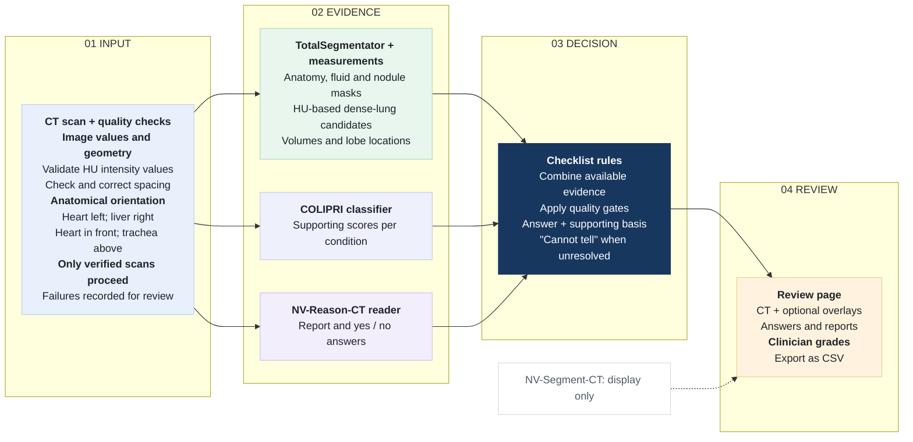
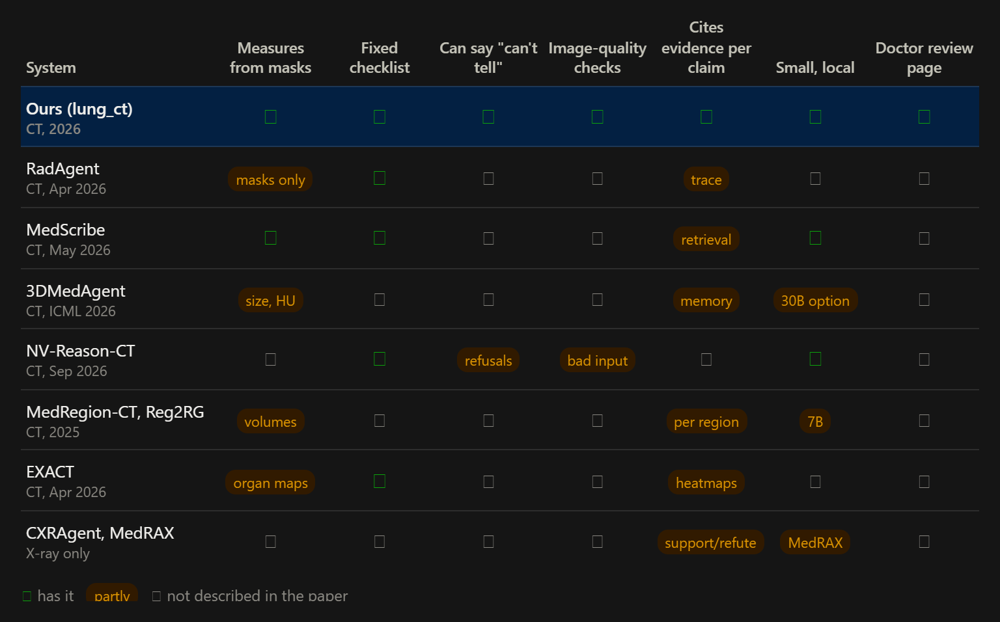

# Lung CT Research

A local research tool that reads a 3D chest CT and answers a fixed checklist of 20 findings (present / absent / cannot tell / cannot assess),
with the evidence behind every answer, on a review page a clinician can grade.
Research use only: no diagnostic use, no clinical validation claim. Everything runs on one workstation; no scan, mask or report is sent anywhere.

**Current state (2026-11-27):** answer policy `checklist_v3_12`, viewer v7, data from CT-RATE (validation split).
Progress and results: [docs/STATUS.md](docs/STATUS.md) · Rules: [PROJECT_GUIDELINES.md](PROJECT_GUIDELINES.md) ·
Earlier phases and versions: [docs/README_HISTORY.md](docs/README_HISTORY.md)

| Document | What it holds |
|---|---|
| [docs/SETUP_AND_RUNNING.md](docs/SETUP_AND_RUNNING.md) | Installing the environments, running the pipeline, page checks and tests |
| [docs/PIPELINE_FLOW.md](docs/PIPELINE_FLOW.md) | Every step, script, environment and output; the order in which an answer is decided |
| [docs/REVIEW_PAGE_FORMAT.md](docs/REVIEW_PAGE_FORMAT.md) | The fixed format of the review page (changes need the project lead's approval) |
| [configs/checklist_v3_12.json](configs/checklist_v3_12.json) | The current answer rules, limits and cut-offs, with the changes from each earlier version |
| [docs/prompt_tests/](docs/prompt_tests/) | Frozen plans and results of the prompt tests and calibration (PT01, PT02, TR01, TR02) |
| [docs/RELATED_WORK.md](docs/RELATED_WORK.md), [docs/PAPER_NOVELTY.md](docs/PAPER_NOVELTY.md) | How this compares with other CT agents; candidate contributions |
| [docs/research/Chest CT model candidates.md](docs/research/Chest%20CT%20model%20candidates.md) | Survey of open chest CT models, with sources |

## How it works: from scan to clinician review

Simplified pipeline · checklist v3_12 · viewer v7. Details: [docs/PIPELINE_FLOW.md](docs/PIPELINE_FLOW.md) (steps, scripts, outputs, decision order),
[docs/REVIEW_PAGE_FORMAT.md](docs/REVIEW_PAGE_FORMAT.md) (the page), [docs/RELATED_WORK.md](docs/RELATED_WORK.md) (how this compares with other CT agents).

1. **Input.** Each CT scan is checked first: are the values real HU, is the voxel spacing right, and is the orientation right from anatomy
   (heart on the patient's left, liver on the right, heart in front, trachea above). Only scans that pass go on; failures are listed, never dropped.
2. **Evidence.** Three independent sources: TotalSegmentator masks and the measurements made from them (volumes, HU ranges, lobe locations,
   fluid and nodule candidates); the COLIPRI classifier (a score per condition); and the NV-Reason-CT reader (a free report and a yes / no per condition).
3. **Decision.** Written, versioned rules (`configs/checklist_v3_12.json`) combine the evidence and apply quality gates. A decisive measurement
   comes first; a mask alone gives "cannot tell"; for pleural effusion and aortic / coronary calcification, "present" needs two agreeing sources.
   Every answer carries its basis; "cannot tell" is the answer when the evidence does not settle it.
4. **Review.** One page per scan shows the CT (with optional outlines), the answers, the tool's report and the AI reader's report; the clinician grades
   each answer and exports a CSV. NV-Segment-CT, a second segmentation model, is shown for comparison only and feeds no answer.

All steps run locally; how to run them is in [docs/SETUP_AND_RUNNING.md](docs/SETUP_AND_RUNNING.md).

## Similar work

How lung_ct compares with published CT agents and grounded CT report models. Full notes, figures and sources: [docs/RELATED_WORK.md](docs/RELATED_WORK.md).

Green box = has it; orange label = partly; empty box = not described in the paper (not the same as "does not have it").

### The two closest

**[RadAgent](https://arxiv.org/abs/2604.15231)** (arXiv 2604.15231) is the most similar idea. A language model calls tools step by step: TotalSegmentator, an effusion segmenter,
the CT-CLIP classifier and CT-Chat. It writes a report and keeps a trace you can inspect. The difference is that the language model decides
everything, and the CT-CLIP classifier gets a full vote. It takes no measurements and never says "can't tell". It also runs on 8 large GPUs.
Think of it as a smart intern who uses tools well but always gives an answer.

**[MedScribe](https://arxiv.org/abs/2605.01779)** (arXiv 2605.01779) is the closest on measurements. It turns TotalSegmentator masks into about 86 numbers: volumes, HU averages
and left / right fractions. It runs locally on Llama 3.1-8B and scores a macro-F1 of about 0.32 on CT-RATE. But the final language model still
decides, with no abstention and no citations inside the report.

### What none of the papers we found do

- Fixed rules make the final call from measurements; no language model decides an answer.
- The checklist has separate "cannot tell" and "cannot assess" answers.
- Quality gates block a call when image noise, lung inflation or contrast make it unsafe.
- A classifier score alone never decides. Since checklist_v3_5 it cannot make anything "absent"; since checklist_v3_12 it can count towards
  "present" only as the second vote next to the AI reader, for three conditions, at cut-offs checked on held-apart scans.
- Every answer names the evidence rows (E-numbers) it rests on. When a language model writes the report, a validator checks that every finding
  cites existing evidence IDs and that every number in it comes from a cited row (`src/lung_ct/agent/report.py`); the review pages use the rule-based report.

### Honest critique

- **We are not more accurate yet.** Our recall is low (for example 15 of 63 findings found on test20b), and our development sets are about
  20 patients each, against their thousands. Reviewers will ask for F1 on the full CT-RATE validation set next to MedScribe and NV-Reason-CT.
  Our newness is in safety and traceability, not in scores.
- **"Not described" is not "not done".** The comparison is from reading the papers, not their code. Commercial tools (for example Aidence,
  Coreline, Siemens AI-Rad) and GitHub projects were not searched. Commercial products measure emphysema and calcium routinely, so
  "measures from masks" alone is not new.
- **Measurements are getting common.** MedScribe and 3DMedAgent already feed volumes and HU to a language model. Our real claim is narrower:
  deterministic rules plus abstention.
- **Two items in the grid are not fully checked:** MedScribe's calcium and heart-size features at code level, and the full text of the NV-Reason-CT paper.

## What runs today

| Part | What it is, in plain words | Environment | How it affects the answers |
|---|---|---|---|
| **Quality check** | Before anything else, each scan is checked. Are the pixel values real CT density units (HU, where air is about -1000 and water 0)? Is the distance between slices right? Is the scan the right way round? We check that last one from the body itself: the heart must be on the patient's left, the liver on the right, the heart in front and the windpipe above it. Done by a Python script written for this project (`scripts/anatomy_contrast_check.py`). | core, plus `segmentation` for the organ outlines | A scan that fails is left out and listed, never used quietly |
| **Segmentation** | TotalSegmentator 2.18, a widely used open model that draws the outline of each body part on every slice: the five lung lobes, windpipe, heart, liver, aorta, airways and vessels, fluid around the lungs and the heart, and possible lung nodules. Think of it as colouring in each organ. | `segmentation` | Gives the outlines that all measurements are made from |
| **Measurements** | Python code written for this project (`src/lung_ct/agent/`, using NumPy, nibabel and SciPy) measures inside those outlines: lung and fluid volumes in mL, how much lung falls in certain density ranges, calcium in the aorta wall, the heart's width compared with the chest, the size and lobe of each nodule candidate, and which lobe a finding is in. | core | Where a measurement is clear, it decides the answer |
| **Classifier** | COLIPRI, a model that looks at the whole scan and gives each finding a score from 0 to 1 ("how much does this scan look like a scan with X"). It was never trained for our checklist and its scores are not probabilities. | `colipri` | A supporting score only; it counts only as the second vote in the two-source rule |
| **AI reader** | NV-Reason-CT, an AI model that "reads" the scan like a junior doctor: it writes a short report and answers yes or no for 18 findings. It was trained on reports from the same hospital as our scans, which may flatter it. | `nvreason` | Shown under every answer; counts only in the two-source rule, never on its own |
| **Second segmentation** | NV-Segment-CT, a second outlining model, so the reader can compare its outlines with TotalSegmentator's. | `nvsegment` | Display only: it never changes an answer |
| **Answer rules** | Written rules (`configs/checklist_v3_12.json`) applied by Python code written for this project (`src/lung_ct/agent/checklist.py`) that combine all of the above into one answer per finding: present, absent, cannot tell, or cannot assess, with the reason. | core | This is where every answer is decided |
| **Review pages** | One web page per scan (viewer v7): the scan you can scroll and adjust, the answers with their reasons, the reports, and buttons for the doctor to grade each answer and save a CSV file. Built by Python scripts (`build_policy_pack.py`, `build_viewer_page.py`); the page itself is a single HTML file with JavaScript, opened from a folder. | core | Where the doctor checks the answers |

**Previously tested** (details in [docs/STATUS.md](docs/STATUS.md) and [docs/README_HISTORY.md](docs/README_HISTORY.md)):

| What was tested | What for | What we found |
|---|---|---|
| MedGemma 1.5 4B (Google) | AI reader answering the checklist, and writer of the report text | In the pilot it answered "absent" to almost everything; replaced as reader by NV-Reason-CT; pages now use the rule-based report |
| Hulu-Med 7B | Second AI reader | Same pattern as MedGemma; replaced by NV-Reason-CT |
| CT-CLIP (zero-shot, VocabFine, ClassFine) | Classifier, compared with COLIPRI on 85 scans | COLIPRI ranked equal or better for most conditions; no CT-CLIP variant adopted |
| HoloCT | A model that writes findings and outlines them | Used to cross-check our dense-lung outlines in the development audit; not used for answers |
| Alternative pleural-fluid model (nnU-Net, Basel) | Replacing TotalSegmentator's pleural-fluid outline | On expert-outlined PleThora scans: slightly higher overlap, but it recovered none of the missed effusions and marked tissue outside the chest; not adopted |
| NV-Segment-CT against TotalSegmentator | Choosing the segmentation model | Against expert lung outlines TotalSegmentator was slightly better and covered diseased lung more fully; NV-Segment-CT kept for display only |
| COVID-19 CT segmentation and airway measurement (Phases 1 to 5) | First version of the pipeline on 20 public COVID-19 scans | Lung volumes, airway tree, branch lengths and tortuosity measured; the project then moved to the CT-RATE checklist |

Some of these environments still exist under `environments/`; the current pipeline does not call them. The `vlm` environment is now used only by the CT-RATE download scripts.

## Data

- **CT-RATE** ([ibrahimhamamci/CT-RATE](https://huggingface.co/datasets/ibrahimhamamci/CT-RATE), CC BY-NC-SA 4.0, gated): validation split only,
  never mirrored in full. Labels are report-derived, not image annotations. Pages and `cases.json` hold report text: keep them within the research group.
  - 85 development scans in `data/raw/ct_rate/volumes` (sets pilot10, test20, test20b, test20c, test20_soft).
  - 400 calibration scans of new patients in `D:/datasets/ct_rate/calib400` (TR02); 46 of them form the two-reader review set RS01
    and are hard-linked into `data/raw/ct_rate/volumes`.
- **COVID-19-CT-Seg** (Zenodo 3757476, CC BY 4.0): 20 scans with expert lung masks, used in the early phases and for the segmentation comparison.
- New downloads go to `D:/datasets/<dataset>/`. There is no fixed size limit; size and source are recorded per download.
- The Hugging Face token lives in the `HF_TOKEN` environment variable only; the batch files ask for it and clear it afterwards.

## Current answer policy in one paragraph (checklist_v3_12)

A decisive measurement answers first. A predicted mask alone (fluid outlined, nodule candidates) gives "cannot tell", with what was outlined listed;
an empty or small mask never means "absent". For pleural effusion, aortic and coronary calcification, "present" also comes from two agreeing sources:
NV-Reason-CT says present and COLIPRI is above that condition's cut-off (or, for pleural effusion, at least 20 mL of fluid is outlined).
A classifier score alone, or a reader alone, never decides. Image-quality gates (noise, lung inflation, contrast) can block an answer.
Cut-offs were fitted on 198 development scans and checked on 197 others against report labels; they are not validated.

## Experiments and where the results are

| Experiment | Result file |
|---|---|
| PT01 COLIPRI prompt wording | [docs/prompt_tests/PT01_colipri_prompts_RESULT.md](docs/prompt_tests/PT01_colipri_prompts_RESULT.md): current prompts stay |
| PT02 NV-Reason-CT wording, reasoning, voting | [docs/prompt_tests/PT02_nvreason_prompts_RESULT.md](docs/prompt_tests/PT02_nvreason_prompts_RESULT.md): current wording stays |
| TR01 / TR02 cut-offs and trust rules (83, then 400 scans) | [TR01](docs/prompt_tests/TR01_cutoffs_and_trust_rules_RESULT.md), [TR02](docs/prompt_tests/TR02_calibration_400_RESULT.md) |
| Model against report, every condition (395 scans) | `runs/TR02_calibration_*/model_vs_report_all_conditions.md` |
| RS01 two-reader review (46 scans) | sample in `runs/RS01_review_sample_20261127`; pages pack M17 (in progress) |
| Segmentation models against expert lung masks | [docs/STATUS.md](docs/STATUS.md) (TotalSegmentator stays) |
