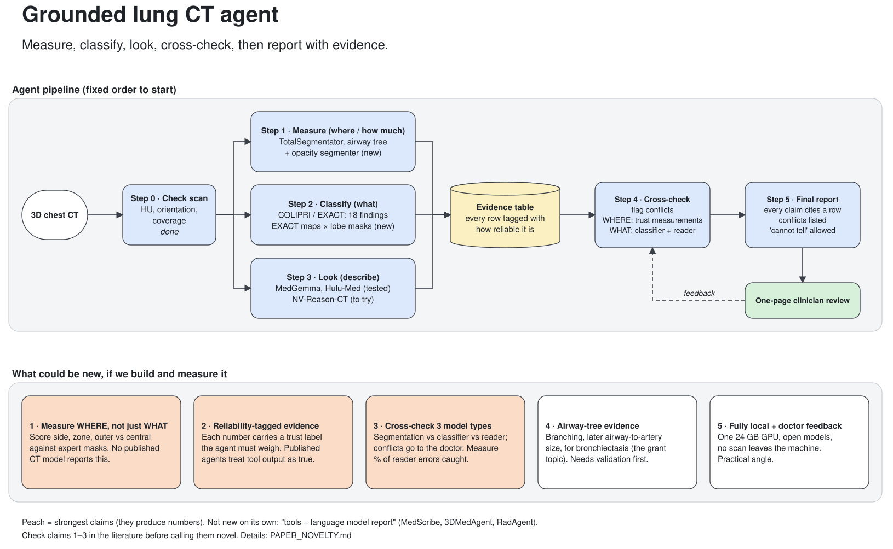
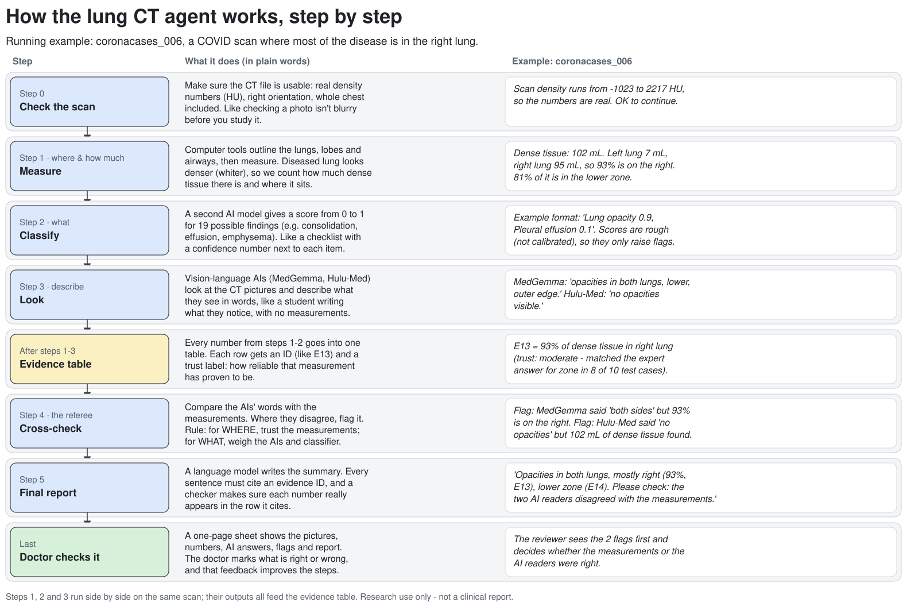
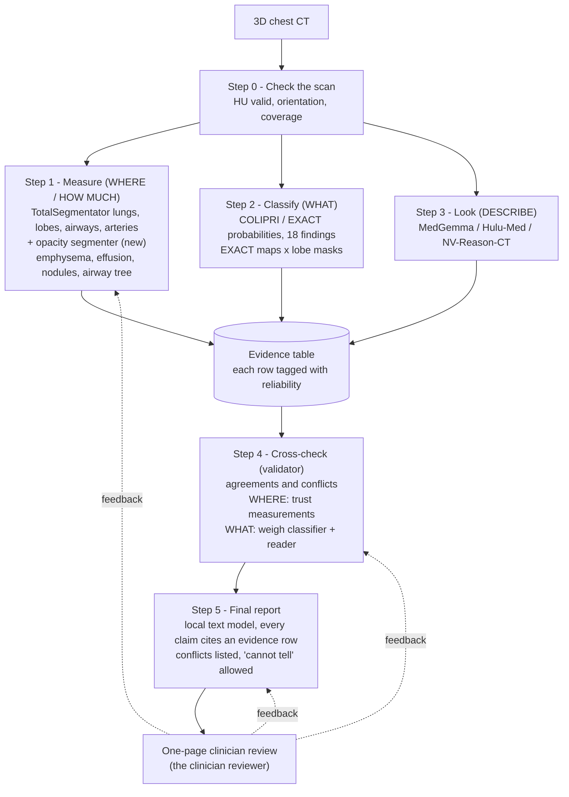

# Project Plan — Grounded Lung CT Diagnosis Agent

> Public project name since 2026-11-27: **ThoraxCheck**, an evidence-based framework for chest CT assessment and clinician review (Python package `lung_ct`). The title above and the revision log are kept as written; the current flow is in [PIPELINE_FLOW.md](PIPELINE_FLOW.md).

Living document. Update it after each professor / clinician meeting: add a row to the
revision log, change task status, and move settled items out of "Open questions".
Day-to-day technical progress stays in `docs/STATUS.md`; this file holds direction and scope.

Status keys: `TODO` · `IN PROGRESS` · `DONE` · `BLOCKED` · `DEFERRED`

Related: [Sample report (how the agent fills it)](SAMPLE_REPORT.md) · [Paper novelty](PAPER_NOVELTY.md) · [Model research report](research/Chest%20CT%20model%20candidates.md) · [Status](STATUS.md) · [Pipeline whiteboard](https://claude.ai/artifact/RYpEXXzpd3BmYk7QShmgi2)

---

## Revision log

| Date | Source | Change |
|---|---|---|
| 2026-11-14 | Professor meeting (transcript) | First version of the plan |
| 2026-11-15 | Model tests + deep research | Added agent pipeline design (steps 0-5), test results for MedGemma / Qwen3-VL / Hulu-Med, link to paper-novelty notes |
| 2026-11-15 | Call with the clinician reviewer and the project lead | Output becomes a condition checklist answering the referring physician's question; no generic "opacity"; contrast status matters; switch from COVID to CT-RATE (10 mixed cases) and review results together before building the review PDF. New workstream G; A1-A4 and B1-B2 updated |
| 2026-11-16 | CT-RATE data check | The original CT-RATE files (`dataset/valid`) have a placeholder header, so the scanner's front/back and left/right directions are lost (first seen as the spine showing at the top). Reversing front/back alone left the heart on the wrong side, so that fix was dropped. Now using the maintainers' corrected files (`dataset/valid_fixed`); every case must still pass the anatomy check before use. Second bug fixed: the corrected files are already in HU, so the -8192 offset is applied only to raw files. Result: all 10 cases pass the anatomy check (verified run `P1_qc_verified_P1_qc_ctrate_10cases_20261116_173748_174459`); all non-contrast (aorta 39-48 HU) |
| 2026-11-16 | Baseline agent run on CT-RATE (10 cases) | Full pipeline ran on all 10 (MedGemma wrote 7 reports, 3 used the rule-based fallback). Baseline misses most radiologist findings (emphysema, bronchiectasis, nodules, lymph nodes, fibrosis, small focal ground-glass); the dense-lung measure flags 20-190 mL of normal gravity-dependent density at the lung bases in normal scans, so every case reads 'bilateral, lower, peripheral'; reports still say 'opacity' / 'dense tissue'. Confirms the need for the condition checklist (G2). Review pages: runs/A1_agent_valid_*_20261116_18* |
| 2026-11-17 | Checklist version built | `configs/checklist_v1.json` (20 conditions, thresholds written down before looking at CT-RATE values), new measurements (contrast, pleural/pericardial effusion, cardiothoracic ratio, aortic calcium, ground-glass and consolidation ranges outside the back-of-lung band), decision rules, reader prompt v2 (MedGemma / Hulu-Med answer each condition), banned word 'opacity', one-page `review_checklist.html`, scoring vs CT-RATE labels. Run: `run_ctrate_checklist.bat` |
| 2026-11-17 | First checklist run (10 CT-RATE cases) | Scores `runs/E6_checklist_scores_20261117_133752`: 128 agree, 4 missed, 11 extra, 37 cannot tell. Effusions, pericardial effusion, enlarged heart and consolidation 10/10. Problems: (1) on sharp, high-resolution reconstructions (Philips 'YA', 0.3 mm pixels) blood noise is 115 HU vs 32 HU normally, so aortic calcium and emphysema (LAA-950) give false positives; (2) both AI readers answered 'absent' to every condition (0 present out of 153 answers) and failed on the sickest case; (3) ground-glass at the lung bottoms just above 3% in 2 normal-ish scans; (4) minimal emphysema and a small focal ground-glass spot missed. Next: noise-aware measurements, test any change on fresh CT-RATE cases |
| 2026-11-17 | Checklist v2 + fresh test set | `configs/checklist_v2.json`: (A) image-noise row E69 (blood SD in the aorta); above 60 HU the threshold measurements use a smoothed copy (checked: 115 -> 15 HU on the grainy pilot scans); (C) AI readers shown but not voting. Other thresholds unchanged, including the ground-glass cut-off, on purpose. (B) `run_ctrate_test20.bat`: 20 new CT-RATE patients (none from the pilot; at least 3 cases per target finding, 4 normals, seed 20261117) to judge v2 fairly. `cases.json` now keeps both sets (`set`: pilot10 / test20) |
| 2026-11-17 | Test20 run (20 fresh CT-RATE cases, checklist_v2) | Scores `runs/E6_checklist_scores_20261117_205523`: 234 agree, 11 missed, 15 extra, 100 cannot tell (360 answers). Where the agent answered present/absent it matched the report label 234 of 260 times (90%, same as the pilot's 128 of 143), but open answers rose from 21% to 28%. Good: pleural effusion 19/20, pericardial effusion 18/20, enlarged heart 18/20. Problems: (1) lung nodule open in all 20 cases although 10 reports mention one (no nodule tool); bronchiectasis open in 18; (2) aortic calcium 7 extra, emphysema 5 extra and 2 missed; most of these extras are on scans with noise of 48-57 HU, just under the 60 HU cut-off for smoothing, so the v2 noise fix works above the cut-off but the cut-off looks too high; (3) lymph nodes missed in 2 of 4. Extras not yet checked by eye (report labels come from text, so some may be real). A page-renderer crash on valid_471 was fixed mid-run (display only); `runs/E6_checklist_scores_20261117_200945` is a duplicate of the pilot scores and not a test20 result. Test20 is now a seen set: any rule change must be judged on new cases. Details in `docs/STATUS.md` |
| 2026-11-18 | test20 result (checklist_v2, 20 new patients) | `runs/E6_checklist_scores_20261117_205523`. Of 59 report-labelled findings: 12 found, 11 missed, 36 cannot tell; 15 extras. Zero extras for pleural effusion, pericardial effusion and enlarged heart. Problems: (1) emphysema LAA-950 tracks image noise: 5 extras on scans with noise 31-56 HU (below the 60 HU smoothing limit), and smoothing pushes LAA to 0 (2 misses); (2) aortic calcium: 7 extras, mostly noise 48-56 HU; (3) smoothing raises ground-glass-range density (valid_1057: 8.9%); (4) lung next to large effusions counts as consolidation (valid_72) - likely compressive atelectasis; (5) no tool yet for nodules (10 labelled, all cannot tell), lymph nodes, bronchiectasis, fibrosis. Render crash on MedGemma 'disagreements' given as objects fixed in the VS Code session |
| 2026-11-18 | Checklist v3 built | Standard-kernel reconstructions instead of sharp `_a_1` (1447 of 1564 scans have one); no smoothing, per-measurement noise limits; breath-in check (E95/E96); emphysema low value = cannot tell, per-lobe and cluster rows shown; compressed lung next to pleural fluid -> atelectasis (E88). Run plan in `docs/HANDOFF.md`: test20_soft (v2 vs v3, same patients) and test20b (20 new patients, the honest v3 score) |
| 2026-11-18 | Checklist v3 results | Same 20 patients (test20): sharp scans v2 = 12 found / 11 missed / 15 extra; soft scans v2 = 11 / 12 / 10 (reconstruction alone); soft scans v3 = 11 / 9 / 6 (new rules). 20 NEW patients (test20b, v3, the honest score): of 63 labelled findings 15 found, 9 missed, 39 cannot tell; 8 extras (v2 on test20 had 15). Emphysema extras gone (low values now 'cannot tell'). Remaining: aortic calcium 5 extras on clean scans (e.g. 8.9 mL in valid_832, probably real but unreported); enlarged heart 2 extras on poorly inflated scans (CTR rises on a shallow breath - gate it like emphysema); 2 PNMS scans have no soft version; nodules, lymph nodes, bronchiectasis still 'cannot tell'. Scores: `runs/E6_checklist_scores_test20soft_v2_*`, `..._test20soft_v3_*`, `..._test20b_v3_*` |
| 2026-11-18 | Checklist v3_1 (heart gate) | Enlarged heart cannot be 'present' when the lungs are poorly inflated (E96/E95); 'absent' still allowed. Re-applied to test20b without recomputing (`scripts/rescore_checklist.py`; the tool reproduces the original v3 scores exactly): extras 8 -> 6, but the one correct enlarged heart (valid_547, also a shallow breath) becomes 'cannot tell'. Not a fair test (rule found on test20b): fresh test = test20c via `run_ctrate_v3.bat download_c` then `test20c` |
| 2026-11-18 | Test20c run (fresh test of checklist v3_1) | 20 new patients (seed 20261119, all soft reconstructions, none from the earlier 50). 2 failed the anatomy check and were left out, not forced through: valid_693 (large heart + effusions; heart centre 7 mm right of the lung midpoint, liver on the right) and valid_64 (liver centre not below the heart centre); both look like limits of the check, not mirrored scans, but were not viewed. Scores on the other 18, `runs/E6_checklist_scores_test20c_v3_1_20261118_155321`: 208 agree, 11 missed, 4 extra, 101 cannot tell (324 answers; 48 labelled findings: 4 found, 11 missed, 33 cannot tell). Where the agent answered present/absent it matched the label 208 of 223 times (93%; test20b with v3: 198 of 215, 92%). Extras fell to 4 (test20b: 8 with v3, 6 with v3_1 re-applied): enlarged heart 0 extra (the heart gate held on new patients), aortic calcium 2 extra (5 on test20b). Weak points: only 4 of 48 labelled findings were called present; pericardial effusion missed in 2 of 3 and pleural effusion in 1 of 2 (first effusion misses on soft scans with v3); consolidation missed in 2 of 4; emphysema 'cannot tell' in all 18; nodule open in 17. MedGemma wrote 13 of 18 reports, 5 rule-based. No rule or threshold was changed during the run. Test20c is now a seen set |
| 2026-11-18 | Checklist v3_2 (wording only) | 'Absent' is no longer written as absence. Reached by a measurement it shows as **none measured** with the detection limit ("No measurable pleural effusion (under 5 mL; a thin rim of fluid can be missed)"; heart: "not enlarged by the axial ratio ... can miss a mildly enlarged heart"); from the classifier alone as **not suggested**. Report writer told never to write 'no X' for these; validator flags it. Decisions unchanged: re-applied to test20c, identical scores (208 / 11 / 4 / 101). Now the default |
| 2026-11-19 | Disk cleanup + meeting pack | Deleted the Hugging Face download cache copies of CT-RATE scans (about 15 GB; every one had a converted copy in `data/raw/ct_rate/volumes`, and all are re-downloadable). CSVs kept. CT-RATE now about 13 GB. Note: an offline re-conversion (`reconvert_ctrate.bat`) now needs a fresh download. Meeting pack (local only, contains CT-RATE images and report text): `runs/M1_meeting_pack_20261119/index.html` + 4 case pages with v3_2 wording |
| 2026-11-19 | Interactive viewer + grading | Meeting-pack cases now open in a NiiVue CT viewer inside the page (scroll, windows, overlays, 'Show in scan' buttons that jump to each finding) with a grading panel: reviewers mark present / absent / can't tell per condition (+ severity, confidence, comment) and save a CSV; `scripts/collect_grades.py` merges them. Not blinded for this testing round (decision 2026-11-19). Zip for SharePoint: `runs/M1_meeting_pack_20261119.zip` |

---

## 1. Goal (as set by the professor)

Build an AI agent for 3D chest CT that works like the earlier chest X-ray agent. The agent should:

- Use **MedGemma** (vision-language model) to make a diagnosis from the CT.
- **Ground** its reasoning in measurements from the classical pipeline (segmentation, lung
  volumes, airway tree metrics, later diameters). Segmentation alone is not new; using its
  numbers to support the model's reasoning is.
- Back each finding with numbers and, where possible, a published diagnostic criterion.
  Example form: *"Consistent with bronchiectasis because <measurement> = X, <measurement> = Y,
  which meets <criterion>."*
- Be able to **call tools** (measurement functions) when it needs a number.
- Cover a **wide range of diagnoses**, including normal scans, not only COVID. Broad, explainable
  output is the main advantage over narrow deep-learning models, which are costly to train and
  often fail on data from other hospitals.

Not every measurement is needed at the start. Begin with a few and add more over time.

## 2. Scope guardrails (from `PROJECT_GUIDELINES.md`)

- Research use only: no clinical validation or autonomous-diagnosis claims.
- No CT images, masks or reports sent to external endpoints; MedGemma runs locally.
- Airway **diameter / tapering is not validated yet**. It must be validated separately
  (phantom or annotated data such as ATM'22 or AeroPath) before the agent uses it as evidence.
  A distance-transform radius is not a validated diameter.
- Fewer detected branches do not by themselves indicate airway loss.

---

## Agent pipeline (design, 2026-11-15)

Fixed order to start (the code runs every step every time; the AI does not choose tools).
Each step is scored against the previous version on the same cases, so the improvement curve
is the result. Candidate novel contributions are tracked in [PAPER_NOVELTY.md](PAPER_NOVELTY.md).



*Same picture as the [pipeline whiteboard](https://claude.ai/artifact/RYpEXXzpd3BmYk7QShmgi2) (editable there). PNG copy for slides or Word: [images/agent_pipeline.png](images/agent_pipeline.png).*

### What each step does, in plain words



*PNG copy for slides: [images/agent_pipeline_explained.png](images/agent_pipeline_explained.png).*

Running example: **coronacases_006**, a COVID scan where most of the disease is in the right lung.

| Step | What it does (plain words) | Example (coronacases_006) |
|---|---|---|
| **0 · Check the scan** | Makes sure the CT file is usable: real density numbers (HU), correct orientation, whole chest included. Like checking a photo isn't blurry before you study it. | Density runs from −1023 to 2217 HU, so the numbers are real. OK to continue. |
| **1 · Measure** (where & how much) | Computer tools outline the lungs, lobes and airways, then measure. Diseased lung looks denser (whiter), so we count how much dense tissue there is and where it sits. | 102 mL of dense tissue: left lung 7 mL, right lung 95 mL, so 93% is on the right. 81% of it is in the lower zone. |
| **2 · Classify** (what) | A second AI model scores 19 possible findings from 0 to 1 (e.g. consolidation, effusion, emphysema), like a checklist with a confidence number next to each item. | Example format: "Lung opacity 0.9, Pleural effusion 0.1". The scores are rough (not calibrated), so they only raise flags. |
| **3 · Look** (describe) | Vision-language AIs (MedGemma, Hulu-Med) look at the CT pictures and describe what they see in words, like a student writing down what they notice, with no measurements. | MedGemma: "opacities in both lungs, lower, outer edge." Hulu-Med: "no opacities visible." |
| **Evidence table** | Every number from steps 1–2 goes into one table. Each row gets an ID (like E13) and a trust label saying how reliable that measurement has proven to be. | E13 = 93% of dense tissue in the right lung (trust: moderate; the zone answer matched the expert in 8 of 10 test cases). |
| **4 · Cross-check** (the referee) | Compares the AIs' words with the measurements and flags every disagreement. Rule: for WHERE, trust the measurements; for WHAT, weigh the AIs and the classifier. | Flag: MedGemma said "both sides" but 93% is on the right. Flag: Hulu-Med said "no opacities" but 102 mL of dense tissue was found. |
| **5 · Final report** | A language model writes the summary. Every sentence must cite an evidence ID, and a checker makes sure each number really appears in the row it cites. | "Opacities in both lungs, mostly right (93%, E13), lower zone (E14). Please check: the two AI readers disagreed with the measurements." |
| **Doctor checks it** | A one-page sheet shows the pictures, numbers, AI answers, flags and report. The doctor marks what is right or wrong, and that feedback improves the steps. | The clinician reviewer sees the 2 flags first and decides whether the measurements or the AI readers were right. |

Steps 1, 2 and 3 run side by side on the same scan; all their outputs feed the evidence table.

See a full worked example of the final report, section by section: [SAMPLE_REPORT.md](SAMPLE_REPORT.md).

Diagram source (Mermaid, renders on GitHub and VS Code):



Plain-text version (for viewers that do not render Mermaid):

```
CT scan
  |
  +- Step 0  Check the scan ........ HU valid, orientation, coverage            [DONE]
  |
  +- Step 1  Measure (where / how much)
  |     TotalSegmentator lungs, lobes, airways, arteries                         [DONE]
  |     + opacity segmenter -> % involved per lung / lobe / zone / periphery     [TODO]
  |     + emphysema, effusion, nodules, airway tree                              [PARTLY]
  |     -> EVIDENCE TABLE, every row tagged with reliability                     [TODO]
  |
  +- Step 2  Classify (what) ....... COLIPRI / EXACT finding probabilities       [TODO]
  |
  +- Step 3  Look (describe) ....... MedGemma, Hulu-Med (tested), NV-Reason-CT   [PARTLY]
  |
  +- Step 4  Cross-check ........... compare 1 vs 2 vs 3, flag conflicts         [TODO]
  |
  +- Step 5  Final report .......... cites evidence rows, lists conflicts        [TODO]
        -> one-page clinician review -> feedback into steps 1, 4, 5
```

| Step | What | Tools / models | Status |
|---|---|---|---|
| 0 | Scan check | `batch_qc.py`, HU check, reorientation | DONE |
| 1 | Measurements + evidence table | TotalSegmentator, airway tree (done); opacity segmenter, HU metrics, reliability tags | IN PROGRESS |
| 2 | Finding classifier | COLIPRI (native Windows), EXACT (needs WSL2, Mamba) | TODO |
| 3 | VLM reader | MedGemma 1.5 4B, Hulu-Med-7B (tested), NV-Reason-CT (OpenMDW-1.1, running locally since 2026-11-25) | IN PROGRESS |
| 4 | Cross-check / validator | rules + text model | TODO |
| 5 | Report writer | local text model | TODO |

Build order: (1) evidence table from existing measurements + cross-check + report writer, run
end to end with MedGemma and Hulu-Med; (2) opacity segmenter; (3) classifier (COLIPRI, then
EXACT); (4) NV-Reason-CT as reader (done 2026-11-25, shown only; see docs/STATUS.md).

Second segmentation (2026-11-26): NV-Segment-CT (the VISTA3D network) runs locally next to TotalSegmentator on the four
graded scans, all supported classes, and is shown in viewer v7 for comparison. It feeds no measurement or answer. Step 1
still rests on TotalSegmentator; whether any class of the second model should be used is undecided (see docs/STATUS.md).

### Model test results so far (10 COVID HU cases, reference rules v2, provisional)

| Question | MedGemma 1.5 4B | Hulu-Med-7B | Qwen3-VL-8B |
|---|---|---|---|
| Opacity present | 10/10 | 7/10 (missed 3 mildest) | 0/1 (1 case only) |
| Side | 6/10 | 6/10 | 0/1 |
| Zone | 3/10 (always "lower") | 3/10 | 0/1 |
| Peripheral vs central | 3/10 | 2/10 | 0/1 |

Neither reader ever answered "one side only". Runs: `runs/P3_vlm_10cases_20261108_083032`,
`runs/P3_hulumed_10cases_20261115_065454`, `runs/P3_qwen3vl_1cases_20261114_113620`;
scores: `runs/E5_vlm_scores_20261115_130340`.

---

## 3. Workstreams and tasks

### A. Meeting prep — Tuesday 2026-11-17 with the clinician reviewer

| # | Task | Status | Notes |
|---|---|---|---|
| A1 | Short slide deck: pipeline, what is measured, how grounding will work, first examples | DEFERRED | Superseded by the 2026-11-15 call: review real outputs first (G6), deck/PDF after | Professor: "start with the PowerPoint"; keep it simple, like the chest X-ray project |
| A2 | Show the slice viewer with the AI overlay and overlay on/off toggle | DONE | Shown in the 2026-11-15 call | Professor liked the existing draft |
| A3 | Ask clinicians to check the current measurements (lung volumes, central airway lengths) | TODO | Professor will ask the clinician reviewer and others |
| A4 | Clearly state what is available now vs next (branching and lengths now; diameters and vessels next) | TODO | Avoid implying diameters are ready |

### B. Grounded agent (core build)

| # | Task | Status | Notes |
|---|---|---|---|
| B1 | Define the "evidence pack" given to MedGemma per case (lung volumes, airway branch counts by generation, lengths, flags) | DONE | Evidence table v1 (`configs/agent_evidence_v1.json`), demo runs `runs/A1_agent_*` | Start with measurements that are already in the pipeline |
| B2 | Prompt design: diagnosis + reasoning that must cite the evidence numbers | IN PROGRESS | Report writer cites evidence IDs; MedGemma output still too long (fallback used); to be reshaped into the checklist (G2) | Reuse the chest X-ray agent pattern |
| B3 | Tool calling: let the agent request a measurement instead of receiving everything up front | TODO | |
| B4 | Map diagnostic criteria to measurable quantities (e.g. bronchiectasis criteria) | TODO | Literature needed; flag criteria that need unvalidated measurements |
| B5 | Baseline vs grounded comparison (MedGemma alone vs MedGemma + evidence) on the same cases | TODO | Shows whether grounding helps |

### C. Wider pathology coverage

| # | Task | Status | Notes |
|---|---|---|---|
| C1 | Choose datasets beyond COVID (normal + several pathologies) within the 20 GB data budget | DONE | CT-RATE chosen (2026-11-15); see G1 | Candidates in README (e.g. CT-RATE subset has bronchiectasis labels) |
| C2 | Run the pipeline and agent on a small mixed set | TODO | |

### G. Condition checklist on CT-RATE (from the 2026-11-15 call)

The doctors want the agent to answer **the referring physician's question** (is there pneumonia? a
mass? something malignant?) as a **list of conditions with a check mark**, like the chest X-ray
project, rather than volumes and generic "opacity". Measurements stay as the evidence behind each
check mark (e.g. "pneumonia: present, right lower lobe").

| # | Task | Status | Notes |
|---|---|---|---|
| G1 | Get 10 CT-RATE cases: mixed disorders + a few normal scans, with their radiology reports and labels | IN PROGRESS | Validation split only (COLIPRI and CT-CLIP were trained on the train split). Gated on Hugging Face: request access; CC BY-NC-SA (research only). Apply the metadata rescale/spacing so values are true HU |
| G2 | Condition checklist output: each condition present / absent / cannot tell, with location and evidence IDs | IN PROGRESS | Built 2026-11-17 (checklist_v1); first run pending. Draft list below; confirm with the clinician reviewer |
| G3 | Contrast detector: blood density in the aorta (TotalSegmentator mask) and DICOM metadata where available | DONE (aorta) | Evidence row E70; pulmonary embolism = cannot assess on non-contrast. Sets "cannot assess without contrast" (e.g. pulmonary embolism) |
| G4 | Terminology: no generic "opacity" in reports; "consolidation" / "ground-glass" only when evidence supports it, else "increased lung density, type not determined" | DONE | Report validator rejects the banned words; reader prompt v2 forbids them. The clinician reviewer: radiologist reviewers will reject "opacity" |
| G5 | Run the full pipeline on the 10 cases; put each agent report next to the real CT-RATE report and labels | TODO | Also gives a first calibration check for the classifier |
| G6 | Meet and review the 10 together; then decide the final condition list and build the review PDF | TODO | Doctors asked to see results before the PDF |

Draft condition list (to confirm with the clinician reviewer):

| Condition | Main evidence | Needs contrast? |
|---|---|---|
| Pneumonia / infection (consolidation, ground-glass) | dense-lung measure + location, classifier, readers | No |
| Mass / suspected malignancy | nodule/mass detector (to add), classifier, readers | Helps |
| Lung nodule | classifier; nodule detector (to add) | No |
| Pulmonary embolism | needs CT angiography | **Yes**: otherwise "cannot assess" |
| Pleural effusion | TotalSegmentator effusion task, classifier | No |
| Pneumothorax | to add | No |
| Emphysema | % lung below -950 HU, classifier | No |
| Bronchiectasis | airway tree (later: airway-to-artery ratio), classifier | No |
| Fibrosis / interstitial lung disease | classifier, readers | No |
| Atelectasis (collapse) | lobe volume loss, classifier | No |
| Lymphadenopathy | classifier, readers | Helps |
| Cardiomegaly | heart size (to add), classifier | No |
| Pericardial effusion | classifier | Helps |

### D. Clinician review

| # | Task | Status | Notes |
|---|---|---|---|
| D1 | **One-page** HTML review per case: dense, everything on one screen, no vertical scrolling | TODO | Professor's explicit request; reviewers zoom themselves; match the chest X-ray layout |
| D2 | Pre-filled scoring sheet for each case (model output + reviewer columns) | TODO | Existing package has scoring CSVs to adapt |
| D3 | Collect the clinician reviewer's feedback and log errors (wrong, missing, unsupported) | TODO | Feeds Workstream E |

### E. Improving performance when the agent is wrong

| # | Task | Status | Notes |
|---|---|---|---|
| E1 | Validator agent that checks the main agent's claims against the evidence | TODO | Same idea as the chest X-ray validator |
| E2 | Literature review: specialized lung CT models / agents; what is novel for us | TODO | |
| E3 | Use clinician feedback to revise prompts, tools and evidence | TODO | |

### F. Later measurement extensions

| # | Task | Status | Notes |
|---|---|---|---|
| F1 | Airway diameter and tapering, with a validation design | DEFERRED | Needs annotated airway data (ATM'22 / AeroPath) |
| F2 | Vessel diameter and airway-to-artery comparison | DEFERRED | Professor asked for this later; key bronchiectasis sign |
| F3 | Parameter-sensitivity sweep for the airway tree (pruning / contraction) | TODO | From `STATUS.md` Phase 5 next steps |

---

## 4. Related: chest X-ray project follow-ups (same meeting)

| # | Task | Status | Notes |
|---|---|---|---|
| X1 | Send the professor the agreement table (doctor vs doctor; doctors vs MedGemma and the chest X-ray agent) | TODO | He wants to work with the numbers |
| X2 | Make clear which table is doctor vs doctor and which shows the chest X-ray agent's performance | TODO | |
| X3 | Investigate *why* the doctors disagree, case by case | TODO | |
| X4 | Simpler summary of performance suitable for a paper | TODO | Fewer numbers |
| X5 | More scored cases so rare conditions are not empty in the table | TODO | Empty cells = no shared cases with those conditions |

---

## 5. Open questions

- ~~Which non-COVID datasets come first?~~ CT-RATE (decided 2026-11-15).
- Final condition list and the wording for each check mark (the clinician reviewer).
- For each condition, which referring questions it answers, and when contrast is required.
- How to calibrate the classifier (CT-RATE labels, normal scans) before its scores can raise flags.
- Which diagnostic criteria (and from which guideline) should the agent cite?
- Pending decisions from the existing clinician review package (`STATUS.md`): readers,
  primary reference, distribution definitions, scoring categories, airway landmarks,
  airway subset size, package transfer.
- Does the professor want the deck for Tuesday in a specific format or template?

## 6. Meeting notes

### 2026-11-15 — Call with the clinician reviewer and the project lead (summary)
- Showed the grounded agent demo and the viewer. Doctors found it helpful.
- **"Opacity" is too general.** A radiologist reviewing the paper will not accept it; use specific
  terms (consolidation, ground-glass). The dense-lung measure cannot tell these apart.
- **Answer the referring physician's question.** CT is ordered to answer things like: pneumonia?
  mass? malignancy? The clinician reviewer is not focused on volumes (e.g. atelectasis lowers volume for other
  reasons). Agreed format: **a list of conditions with a check mark**, like the chest X-ray project.
- **Contrast matters.** Some questions (e.g. pulmonary embolism) need a contrast CT; masses and lymph
  nodes can be judged without contrast but contrast helps. The agent must know and say this.
- **COVID is too narrow.** Pick one dataset with multiple disorders and stick with it.
- **Next:** gather a few cases, produce outputs next to the ground truth, meet and go over them, then
  decide what to build (condition list, review PDF). The project lead: collect a few cases, get reports
  out, add heterogeneity, not just COVID.
- Decision after the call: CT-RATE, 10 cases, validation split.

### 2026-11-14 — Professor meeting (summary)
- Wants a grounded agent "just like the chest X-ray one", diagnosing with numbers as evidence.
- Liked the slice viewer with overlay and the pre-filled scoring sheet.
- Review pages must fit on one screen.
- Show a wide range of diagnoses, not only COVID.
- Next step for improvement: validator agent + literature on specialized lung CT models.
- Later: vessel diameters and airway vs vessel.
- Chest X-ray: send the table, explain disagreements, simplify the metrics.
- Next meeting: Tuesday 2026-11-17, same time, with the clinician reviewer.
