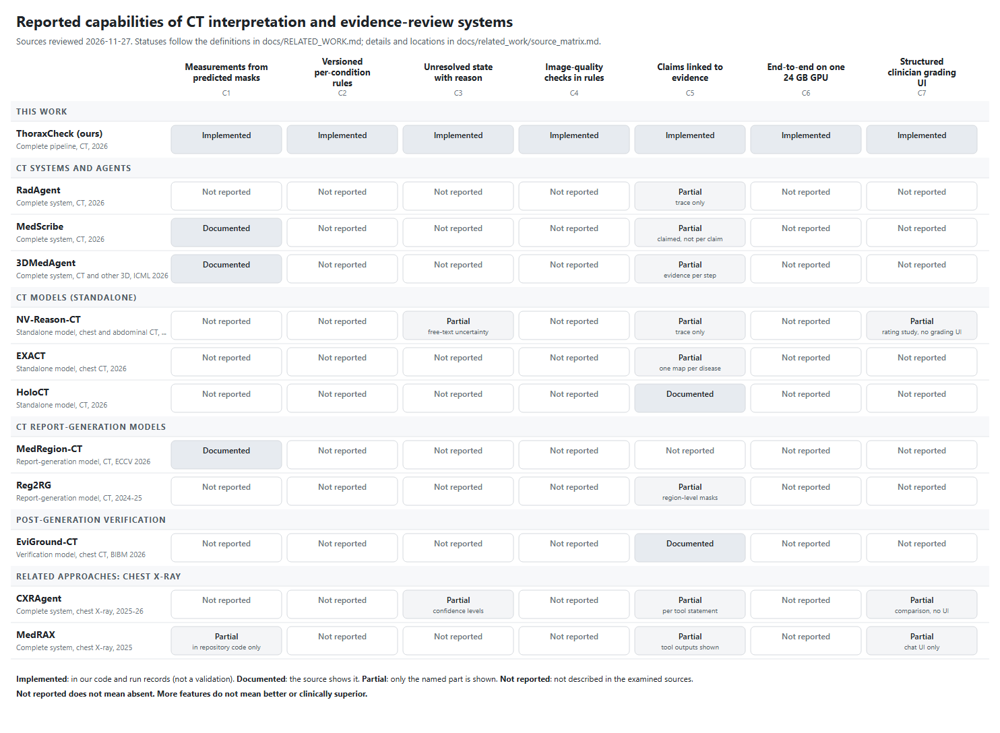

# Related work: reported capabilities of CT interpretation and evidence-review systems

Status: revised 2026-11-27 against primary sources (papers, supplements, official repositories, model cards). Source review date: 2026-11-27.
Every cell, with its source, location and version: [related_work/source_matrix.md](related_work/source_matrix.md).
Table and figure are generated from one data file: `scripts/make_comparison_figure.py`.
Related: [PAPER_NOVELTY.md](PAPER_NOVELTY.md), [research/Chest CT model candidates.md](research/Chest%20CT%20model%20candidates.md), [PIPELINE_FLOW.md](PIPELINE_FLOW.md).

## 1. Criteria

The same definitions apply to every system, including ours.

| # | Criterion | Definition |
|---|---|---|
| C1 | Quantitative measurements from predicted masks | At inference the system computes numeric quantities (volume, HU statistics, size or diameter, count, ratio) from segmentation masks it predicts, and uses them in its output. |
| C2 | Explicit, versioned per-condition decision policy | The final answer for each condition comes from documented, deterministic, condition-specific rules (thresholds, precedence) with a version identifier. |
| C3 | Explicit unresolved state with a recorded reason | The output schema has a state distinct from present / absent, emitted under defined conditions, with a reason recorded per item. |
| C4 | Image-quality checks linked to decision rules | Measured image-quality properties (noise, inspiration, contrast phase, HU validity, orientation, artefacts) change or block answers. |
| C5 | Assessments linked to identifiable evidence sources | Each assessment or report claim references specific evidence items (measurement identifiers, tool outputs, masks or regions) a reviewer can inspect. |
| C6 | End-to-end execution demonstrated on one 24 GB GPU | The complete system is reported running on one GPU with at most 24 GB, or with a whole-pipeline peak memory of at most 24 GB. |
| C7 | Review interface with structured clinician grading | Clinicians view the scan and outputs in an interface and record structured per-item grades that are stored or exported. |

Distinctions applied:
- Fixed classification labels, report templates or question answering are not explicit decision rules (C2).
- A verbal refusal or a confidence level is not policy-controlled abstention (C3: Partial at most).
- Input-format checks or preprocessing are not image-quality gates that affect answers (C4).
- A reasoning or tool-call trace is not a claim-to-evidence link (C5: Partial at most).
- A mask, crop or heatmap is not a quantitative measurement (C1).
- Model parameter count does not establish whole-pipeline hardware requirements; a cloud language-model API means the pipeline is not on one local GPU (C6).
- Having a review page does not establish clinical effectiveness (C7).

Statuses: **Documented** (the source explicitly shows it), **Partial** (only the named part is shown), **Not reported** (the examined sources do not
describe it), **Unverified** (insufficient access). For ThoraxCheck: **Implemented** (in code and run records); validation is stated separately in section 4.

**Not reported does not mean absent.** More implemented features do not make a system more accurate or clinically superior.

## 2. Table

The same table as text, with short labels for Partial cells: [related_work/comparison_table.md](related_work/comparison_table.md).

## 3. What the sources say, system by system

**Complete CT systems and agents**
- **[RadAgent](https://arxiv.org/abs/2604.15231)** (Roschewitz et al., v2): a Qwen3-14B agent calls TotalSegmentator-based segmentation tools, CT-CLIP, CT-Chat,
  a slice-VQA model and slice-selection tools, and keeps a scratchpad and tool-call trace. The segmentation tools return masks; no tool reports a
  volume, HU value or size. The language model makes every decision; there is no designed indeterminate state; reported on eight GPUs on two nodes.
- **[MedScribe](https://arxiv.org/abs/2605.01779)** (Orlando et al., v1): 86-dimensional features from TotalSegmentator masks (volumes, extent,
  laterality fractions, HU statistics, coordinates) feed a prompted language model with retrieval. No calcium or heart-size feature is defined in the
  paper; code is not public. Single H100 reported.
- **[3DMedAgent](https://arxiv.org/abs/2602.18064)** (Wang et al., ICML 2026, v2; [repository](https://github.com/jinlab-imvr/3DMedAgent)): organ size,
  mean HU and z-range are computed from predicted masks into a memory (Eq. 1), and the repository adds lesion volume, HU and location. The repository's
  structured-report code covers abdominal organs. A multimodal language model gives the answer.

**Standalone CT models**
- **[NV-Reason-CT](https://arxiv.org/abs/2609.27511)** (Myronenko et al., v2; [model card](https://huggingface.co/nvidia/NV-Reason-CT)): a single
  vision-language model for chest and abdominal CT, trained to state uncertainty in free text; a reasoning trace not tied to claims. It is **also a
  component of ThoraxCheck** (the AI reader). Its row describes the model as published; our own measurement (12.6 GB peak on a 24 GB GPU) is not from its sources.
- **[EXACT](https://arxiv.org/abs/2604.24146)** (Bai et al., v2): 18 disease-specific anomaly maps, each restricted to an assigned anatomical region,
  with per-disease thresholds fitted on ROC curves per cohort. No licence was found in the repository or paper.
- **[HoloCT](https://arxiv.org/abs/2611.06471)** (Xie et al., v1; title "A 3D foundation model unifying CT interpretation and segmentation"): one predicted
  3D mask per reported finding; no measurements derived from the masks.

**CT report-generation models**
- **[MedRegion-CT](https://arxiv.org/abs/2506.23102)** (Kyung et al., ECCV 2026, v3): volume, maximum diameter and location of lesions from TotalSegmentator
  pseudo-masks are given to the language model as text. (Version 1 described count, diameter and location; v3 describes volume, maximum diameter and location.)
- **[Reg2RG](https://arxiv.org/abs/2411.15539)** (Chen et al., v2): anatomical region masks (SAT-Pro when not provided) are encoded as learned features;
  each region-level report is tied to its region mask.

**Post-generation verification**
- **[EviGround-CT](https://arxiv.org/abs/2610.33038)** (Li et al., BIBM 2026): for each positive sentence of a generated report it predicts a 3D evidence mask.
  At inference it needs only the CT and the report; reference masks (ReXGroundingCT) are used for training and to decide "supported / unsupported" at evaluation.

**Related approaches: chest X-ray**
- **[CXRAgent](https://arxiv.org/abs/2510.21324)** (Lou et al., v2): a director language model with an evidence-driven validator that lists supporting and
  refuting evidence for each tool statement, with confidence levels. The name is shared by other papers (CXR-Agent, arXiv 2407.08811).
- **[MedRAX](https://arxiv.org/abs/2502.02673)** (Fallahpour et al., v2): GPT-4o orchestrates X-ray tools; repository code computes area and intensity from
  predicted masks, but their use in answers is not reported. Chat interface.

## 4. ThoraxCheck (this work): what is implemented, and what is not established

Verified on 2026-11-27 against the current code (checklist_v3_12) and completed run records.

| Criterion | Implemented as | Not established |
|---|---|---|
| C1 | Volumes, HU-range regions, aortic calcium, heart ratio, fluid volume and nodule candidates from TotalSegmentator masks (`src/lung_ct/agent/evidence.py`, `conditions.py`) | Accuracy of the measurements against expert reference, beyond whole lungs on 10 COVID-19 scans |
| C2 | Per-condition limits, precedence and a two-source rule in `configs/checklist_v3_12.json`, applied by `checklist.py` | Limits and cut-offs were fitted on development scans from one hospital; none is validated |
| C3 | "Cannot tell" and "cannot assess" with a stored basis per item, shown on the page and exported (e.g. valid_592_a_1: 14 of 20 unresolved, all with a basis) | Whether unresolved answers are the right ones to withhold |
| C4 | Noise, lung-inflation and contrast gates change answers; HU validity and anatomical orientation exclude scans before analysis | Gate limits are not validated; on the 10 RS01 scans only the contrast gate fired (pulmonary embolism, 10 times) |
| C5 | Each item lists evidence row IDs and names model sources (valid_592_a_1: 19 of 20 items list IDs, all resolve) | The evidence items are computed from one segmentation and are **not statistically independent** |
| C6 | All ten steps completed for 10 scans on one RTX 3090 (24 GB), models run one after another; peak 12.6 GB (NV-Reason-CT) | 36 further scans were still running at review time |
| C7 | Per-item grading form, CSV export and collection; browser-tested; used by one clinician on 4 development scans | Reader reliability, usability and clinical effectiveness; the two-reader review RS01 is in preparation |

Implemented safeguards are not validated safeguards. Results so far are on development scans against report-derived labels; recall against those labels is
low (for example 15 of 63 findings found on test20b), and no F1 on the full CT-RATE validation set has been computed.

## 5. Positioning

ThoraxCheck combines quantitative CT evidence, explicit condition-specific decision rules, recorded uncertainty and structured clinician review.
Its contribution must be established through evaluation of assessment reliability and traceability, rather than through feature coverage alone.

Points of contact in the literature: mask-derived measurements are documented in MedScribe, 3DMedAgent and MedRegion-CT; finding-level evidence links
are documented in HoloCT and EviGround-CT. In the sources examined, no system documents C2, C3 or C4 as defined here. This is a statement about the
examined sources, not proof of absence; commercial products and code repositories were not searched systematically.

## 6. Limits of this comparison

- The sources were read through their HTML or PDF versions; several were read with a summarising tool, so section numbers should be checked against the PDFs before citation.
- Not examined: PDFs of every paper, all supplements, RadAgent v1, the OpenReview page of 3DMedAgent, full code trees, the NV-Reason-CT web demo.
- Commercial software (for example Siemens AI-Rad Companion, Aidence, Coreline) was not reviewed; such products measure emphysema and calcium routinely.
- Criteria were chosen by us; another set of criteria would rank the systems differently.

## 7. Change log of this comparison (2026-11-27)

**Corrected**
- 3DMedAgent, C1: Partial -> Documented (paper Eq. 1 and repository measurements).
- RadAgent, C1: "masks only" -> Not reported (tools return masks; no volume, HU or size is computed).
- RadAgent and MedScribe, "fixed checklist": a fixed label list is not a decision policy -> C2 Not reported.
- NV-Reason-CT and EXACT, "fixed checklist": fixed disease labels and ROC thresholds are not a decision policy -> C2 Not reported.
- NV-Reason-CT, "refusals" and "bad input": free-text uncertainty -> C3 Partial; README input requirement without a described check -> C4 Not reported.
- NV-Reason-CT, "small, local": parameter count does not establish a whole-pipeline figure -> C6 Not reported (our own 12.6 GB measurement noted separately).
- MedRegion-CT and Reg2RG separated: MedRegion-CT C1 Documented; Reg2RG C1 Not reported, C5 Partial.
- CXRAgent and MedRAX separated and grouped as chest X-ray approaches; both use cloud language-model APIs (C6 Not reported).
- MedScribe: no calcium or heart-size feature is defined in the paper (earlier note said this was unchecked).
- The earlier list "What none of the papers do" overstated: HoloCT and EviGround-CT document per-finding evidence links (C5).
- Our row: "can say cannot tell" and "cites evidence" restated as implemented with their limits; "evidence" no longer implies independent sources.

**Added**: HoloCT, EviGround-CT (finding-level grounding and post-generation verification).

**Uncertain (open source questions)**
- MedRAX GPU: Quadro RTX 6000 (24 GB) or RTX 6000 Ada (48 GB); memory not reported.
- MedRAX: whether the repository's mask measurements reach the final answers.
- 3DMedAgent: whether the chest results used the abdominal structured-report code; whether contrast phase is measured or supplied.
- Reg2RG: whether SAT-Pro runs at test time or provided masks are used.
- HoloCT, MedRegion-CT, NV-Reason-CT: inference memory on a 24 GB GPU is plausible but not reported.
- EviGround-CT: no code release, so the extractor rules cannot be checked.
- CXRAgent: full repository not audited; the paper and repository name the validator component differently.

**Unsupported (removed)**: "RadAgent runs on 8 large GPUs" is kept only as "eight GPUs on two nodes" (GPU sizes not reported); "small, local" for MedScribe
(single H100, memory not stated) and for 3DMedAgent and MedRegion-CT (no memory figure) are now Not reported.
