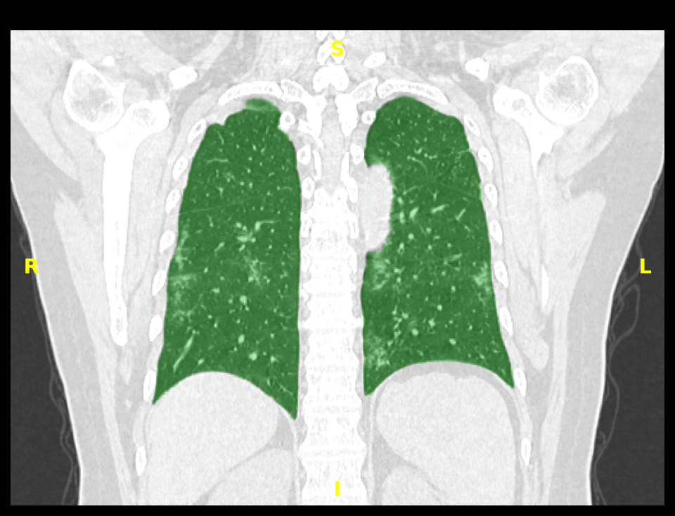
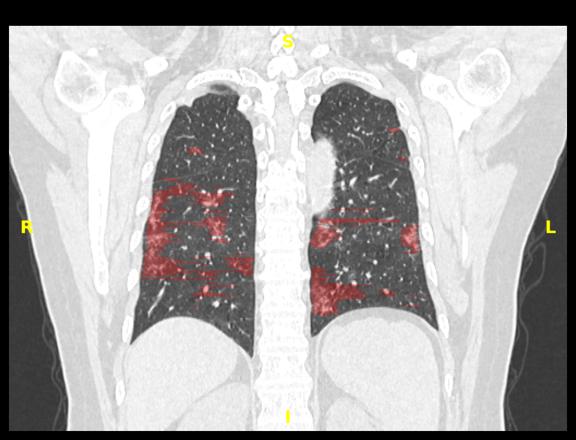
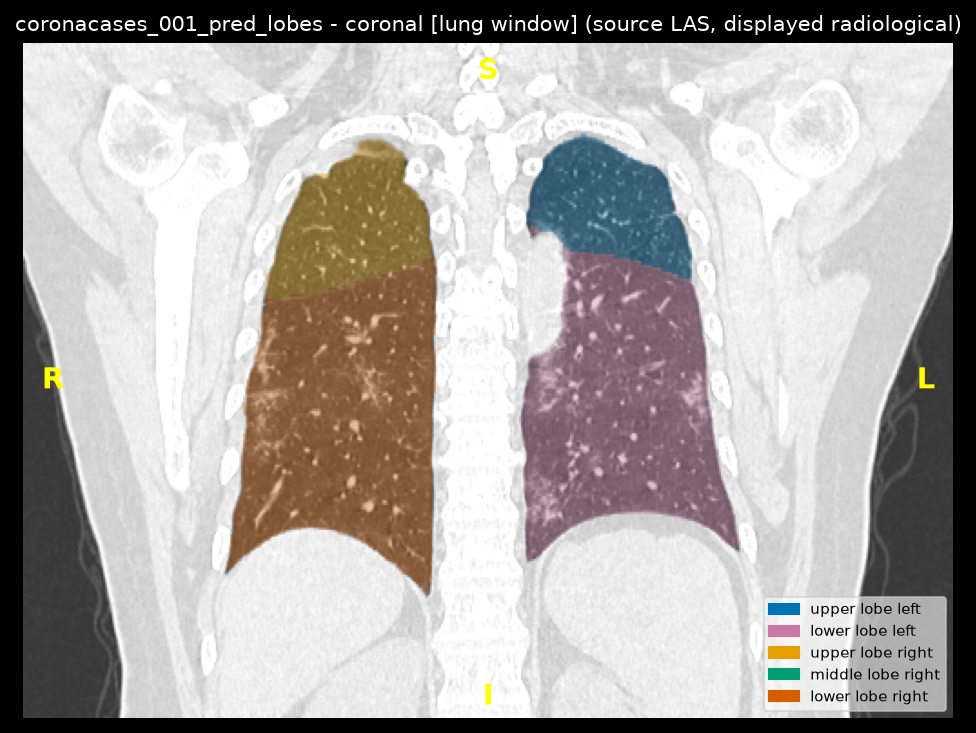
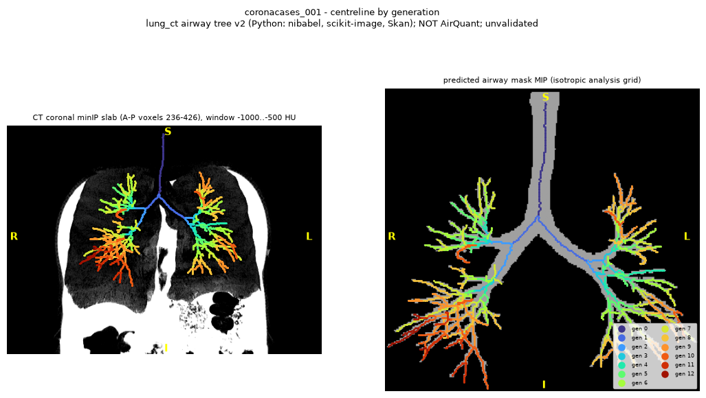

# Example results: COVID-19-CT-Seg dataset

This page shows the kind of measurements the pipeline produces, using the first dataset we
analysed: the COVID-19 CT Lung and Infection Segmentation dataset (Zenodo
[3757476](https://zenodo.org/records/3757476)). See the [README](../README.md#datasets-used)
for dataset details.

**These are research feasibility outputs, not clinical findings.** The pipeline makes no
diagnostic, accuracy or clinical-validity claim. All 20 CTs in this dataset are COVID-19
positive, so nothing here says anything about disease detection or specificity.

## Source runs

All numbers and images are copied unchanged from these runs (outputs are not in the
repository; regenerate them with the commands in the README):

| Stage | Run |
|---|---|
| Segmentation evaluation (Phase 2) | `P2_eval_10cases_20261108_092055` |
| Airway tree (Phase 5) | `P5_airway_10cases_20261108_092858` |
| Case reports (Phase 4) | `P4_report_20cases_20261108_095004` |

Only the 10 `coronacases_*` CTs are in HU and were analysed. The 10 `radiopaedia_*` CTs are
8-bit display-scaled and were excluded by protocol before any HU-dependent stage.

MedGemma (Phase 3) outputs are deliberately **not** shown here. They are under blinded
clinician review.

## Example case: coronacases_001

CT: 512 x 512 x 301 voxels, spacing 0.81 x 0.81 x 1.0 mm, orientation LAS, HU range
-1021 to 2996 (HU valid). All images are shown in radiological convention (patient right on
the image left), with laterality labels added from the image geometry.

### 1. Expert reference lung mask

The lung mask supplied with the dataset (green). This is the **reference**, not a model
prediction.

### 2. Expert reference infection annotation

The COVID-19 infection mask supplied with the dataset (red). It is an infection annotation,
**not** a ground-glass, consolidation or fibrosis label.

### 3. Predicted lung lobes (TotalSegmentator)

Lobes predicted by TotalSegmentator 2.18.0. This is a **prediction**; there is no lobe
reference in this dataset, so lobe volumes are unvalidated.

### 4. Airway centreline tree

Airway centrelines from our own Python implementation ("lung_ct airway tree v2": nibabel,
scikit-image, Skan), coloured by generation (trachea = generation 0). Left: centreline on a
coronal minimum-intensity slab of the CT. Right: centreline on the predicted airway mask.
The airway mask is a TotalSegmentator prediction and there is no airway reference in this
dataset, so these measurements are **unvalidated**. This is not AirQuant and makes no claim
of equivalence to it.

### Measurements for coronacases_001

| Measurement | Value | Source |
|---|---|---|
| Lung volume, left / right / total | 1,516.8 / 1,802.9 / 3,319.7 mL | Expert reference mask |
| Lung volume, left / right / total | 1,516.3 / 1,804.8 / 3,321.2 mL | TotalSegmentator prediction |
| Dice vs reference, left / right / total | 0.981 / 0.984 / 0.983 | Prediction vs reference |
| Volume error vs reference, left / right | -0.03 % / +0.11 % | Prediction vs reference |
| Infection volume (% of lung), left / right | 155.0 mL (10.2 %) / 273.6 mL (15.2 %) | Expert reference masks |
| Infection burden, whole lung | 428.5 mL, 12.9 % of lung | Expert reference masks |
| Lobe volumes: left upper / left lower | 852.1 / 664.2 mL | Prediction (unvalidated) |
| Lobe volumes: right upper / middle / lower | 689.4 / 379.5 / 735.9 mL | Prediction (unvalidated) |
| Airway branches (terminal) | 290 (135) | Airway tree (unvalidated) |
| Maximum generation | 12 | Airway tree (unvalidated) |
| Branches by side, left / right | 121 / 168 | Airway tree (unvalidated) |
| Total centreline length | 3,639.9 mm | Airway tree (unvalidated) |
| Median tortuosity (internal branches) | 1.025 | Airway tree (unvalidated) |

Volume (mL) = voxel count x voxel volume (mm³) / 1000. Tortuosity = branch path length /
straight-line distance between its endpoints (1.0 = perfectly straight). The airway tree for
this case still had 15 loops after cleanup (touching branches or skeleton artefacts);
generations use the shortest-path tree.

## All 10 HU cases

| Case | Ref. lung L / R (mL) | Pred. lung L / R (mL) | Dice L / R | Volume error L / R (%) | Ref. infection burden (%) | Airway branches | Max gen. | Centreline (mm) | Median tortuosity |
|---|---|---|---|---|---|---|---|---|---|
| coronacases_001 | 1517 / 1803 | 1516 / 1805 | 0.981 / 0.984 | -0.03 / 0.11 | 12.9 | 290 | 12 | 3640 | 1.025 |
| coronacases_002 | 2148 / 2481 | 2160 / 2471 | 0.981 / 0.985 | 0.54 / -0.40 | 4.1 | 282 | 13 | 2959 | 1.017 |
| coronacases_003 | 1532 / 1973 | 1538 / 1982 | 0.977 / 0.979 | 0.36 / 0.45 | 29.6 | 276 | 12 | 3110 | 1.013 |
| coronacases_004 | 2137 / 2405 | 2139 / 2409 | 0.984 / 0.987 | 0.06 / 0.15 | 1.4 | 376 | 13 | 4785 | 1.023 |
| coronacases_005 | 2125 / 2627 | 2142 / 2636 | 0.983 / 0.987 | 0.79 / 0.34 | 1.7 | 373 | 12 | 5048 | 1.024 |
| coronacases_006 | 2160 / 2278 | 2152 / 2261 | 0.985 / 0.986 | -0.36 / -0.77 | 2.9 | 203 | 11 | 2398 | 1.017 |
| coronacases_007 | 1368 / 1554 | 1374 / 1547 | 0.980 / 0.981 | 0.44 / -0.44 | 3.1 | 241 | 11 | 2768 | 1.025 |
| coronacases_008 | 1717 / 2108 | 1711 / 2087 | 0.982 / 0.985 | -0.32 / -1.02 | 7.6 | 312 | 12 | 3616 | 1.022 |
| coronacases_009 | 1231 / 1413 | 1235 / 1396 | 0.980 / 0.980 | 0.29 / -1.17 | 4.0 | 194 | 13 | 1891 | 1.030 |
| coronacases_010 | 984 / 1295 | 983 / 1303 | 0.974 / 0.976 | -0.13 / 0.59 | 17.7 | 141 | 11 | 1515 | 1.029 |

Summary across the 10 cases:

- **Lung segmentation agrees closely with the expert masks:** Dice 0.974–0.985 (left) and
  0.976–0.987 (right); volume error -0.36 to +0.79 % (left) and -1.17 to +0.59 % (right).
- **Infection burden** (from the expert annotation, not predicted) ranges from 1.4 % to 29.6 %
  of lung volume.
- **Airway trees** have 141–376 branches and reach generation 11–13.

## How to read the airway numbers

- **Fewer detected branches do not mean airway loss.** How many branches are visible depends
  on the segmentation, scan resolution, inspiration level and reconstruction.
- **Total branch counts are not robust.** In a parameter sensitivity test, the first two
  generations were stable in all 10 cases. Total branch counts were unstable in 7 of 10
  cases. Stability only means the value changed little when processing settings changed. It
  says nothing about anatomical accuracy.
- **Diameter, tapering and wall thickness are not computed.**

## Data licence and citation

Images on this page are derived from the COVID-19-CT-Seg dataset, licensed
[CC BY 4.0](https://creativecommons.org/licenses/by/4.0/): Ma J. et al., COVID-19 CT Lung and
Infection Segmentation Dataset, Zenodo, doi:[10.5281/zenodo.3757476](https://doi.org/10.5281/zenodo.3757476).
Overlays, colours and annotations were added by this pipeline.
